# Making a quest with the map editor: The Thistlewick Howl

This tutorial builds a small, complete custom quest with ToriRSEd, the map
editor in this repository, from an empty patch of map to a promoted lane:

- a village of four map squares, with hills, a stream, a pond, roads,
  decorated houses, a mill and a sheep pen;
- three characters of its own, one of them walking a patrol route;
- dialogue that follows the quest's stages, written in VS Code;
- a searchable loc and a locked door with their own triggers;
- a cutscene with a pathed camera, played inside the den;
- a private, instanced den with a boss that has one telegraphed special
  attack, in the style of Brutus from The Ides of Milk;
- a journal, a completion scroll and rewards.

Everything on the map was made in the editor. The RuneScript was written in
an ordinary text editor, which is how this editor expects scripts to be
written: it makes the files, names and snippets, and opens them in your
editor; it does not write scripts for you.

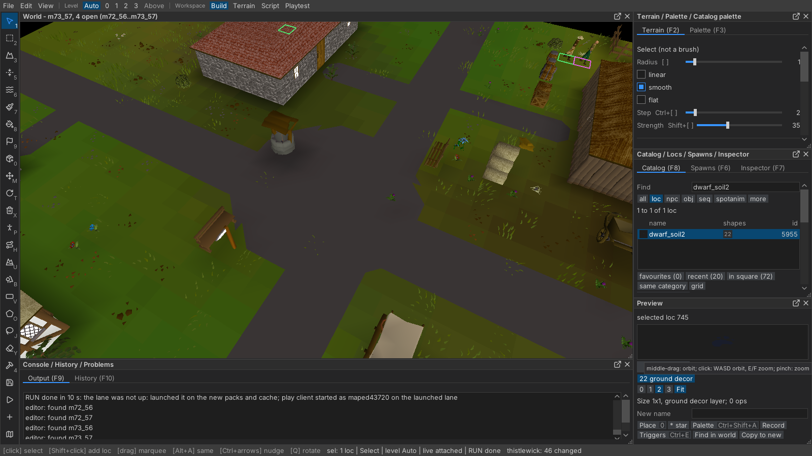

**The story.** Thistlewick's mill was built over the mouth of an old cave.
Elder Bramwen's grandmother told of a great grey wolf, Greyfang, that once
denned in it; the villagers walled the cave off behind the mill's cellar and
forgot it. The miller died last winter and the mill stands shut. Now sheep
vanish at night, and a howl comes up out of the ground.

Bramwen tells you the legend and sends you to Odo, who sat up with the flock:
he saw a grey shape take a ewe and followed its tracks into the shut mill, to
the cellar door. The miller left Odo the key, and Odo hid it at the bottom of
the hay bales to keep the village children out of the cellar. Behind the door
the cellar wall has fallen in: the cave is open again, and Greyfang lies on a
bed of straw among the bones of the flock. Bring his pelt to the elder, and the
legend turns out to be true.

Contents:

1. [Before you start: a scratch lane](#1-before-you-start-a-scratch-lane)
2. [Four new map squares](#2-four-new-map-squares)
3. [Shaping the land](#3-shaping-the-land)
4. [Buildings](#4-buildings)
5. [Decorating](#5-decorating)
6. [Records of your own: copies with their own identity](#6-records-of-your-own-copies-with-their-own-identity)
7. [Npcs and a patrol route](#7-npcs-and-a-patrol-route)
8. [The quest's scripts, in VS Code](#8-the-quests-scripts-in-vs-code)
9. [Dialogue and triggers](#9-dialogue-and-triggers)
10. [A cutscene with a pathed camera](#10-a-cutscene-with-a-pathed-camera)
11. [Instances: templated, then stamped](#11-instances-templated-then-stamped)
12. [The boss](#12-the-boss)
13. [Journal, completion and rewards](#13-journal-completion-and-rewards)
14. [RUN, and playing it](#14-run-and-playing-it)
15. [Promoting the scratch lane](#15-promoting-the-scratch-lane)
16. [Things that catch people out](#16-things-that-catch-people-out)

Throughout, **bold** names are the labels on screen and `code` names are the
action ids you can bind or call from the agent API (`docs/AGENT_API.md`); the
full list is `docs/MAPED_HOTKEYS.md`.

---

## 1. Before you start: a scratch lane

A **lane** is your own copy of the content tree, `build/lanes/<name>/content`.
It is cheap: it starts as links to `OSRS-Content/osrs-content`, and a file
becomes the lane's own the moment the editor writes it. Nothing you do in a
lane touches the base tree until you publish it, so all of this tutorial
happens in a scratch lane that is promoted to a real one at the end.

Start the editor on the map-editor manifest (the README's *Map editor*
section), then open **File > Publish...** (`file.publish`; the status bar's lane
chip opens it too). On its **Lanes** tab press **Scratch lane** (Ctrl+Shift+N):
the editor makes `scratch-<date>` and switches to it at relaunch. Or name it
yourself: put `lane=scratch-thistle` under `[editor:boot]` in a copy of the
manifest.

The status bar's right-hand chip always says which lane you are in and how
many files it has changed: `scratch-thistle: 46 changed`. Check it before you
save anything.

## 2. Four new map squares

The map is made of **squares** of 64 x 64 tiles, named `m<x>_<z>`. A "chunk"
in the brief is a square here, so a village of four chunks is a 2 x 2 block:
`m72_56`, `m73_56`, `m72_57` and `m73_57`, with the village where the four
meet (tile 4672, 3648). Squares from x 66 to 89 are free; x 90..96 at z 240+
are kept for scratch squares, and x >= 100 is where instances are stamped
(section 11).

**File > New square...** (Ctrl+N, `file.new`):

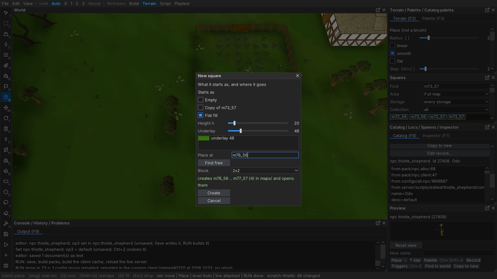

1. **Starts as**: *Flat fill*. **Height h** 20 (the default: ground a little
   above the lowest, so a pond can be sunk into it later), **Underlay** 48
   (grass).
2. **Place at**: `m72_56` (the block's south-west square), or press **Find
   free**.
3. **Block**: `2x2`.
4. The line above **Create** says what will happen: *creates m72_56 .. m73_57
   (4) in maps/ and opens them*, or why not (*m72_56 already exists*).
5. **Create**. The four squares are made, saved, and open together as one
   128 x 128 scene.

Later, to open them again: the **Squares** panel (`view.squares`), **Find**
`m72_56`, **Open**; then type each neighbour into Find and press **Add to open
set** (no Enter needed; pressed while the square list is still loading, it
waits for it: *Add: the square list is still loading; it adds when it
arrives*). The World panel's title says what you are looking at: *World -
m72_56, 4 open (m72_56..m73_57)*, the square at the middle of the view first.
Or
**File > Open squares...** (Ctrl+O) and drag over the four cells on the Square
map. **Close square** (`file.close_square`) drops one again. A scene is at
most 4 x 4 squares: a far square is refused rather than stretching the scene.

## 3. Shaping the land

Switch to the Terrain workspace (**Workspace: Terrain** on the menu bar,
Ctrl+2). Every tool below is on the left tool rail; its options are in the
**Terrain** panel (F2) and its floors in the **Palette** (F3).

A real RuneScape area is never one flat colour, and never flat. Before
shaping anything, look at a real village in the editor (Squares > Find
`m46_50`, Rimmington, **Open**; do not save it) and read its files: the
numbers below come from Rimmington, Draynor and Taverley's `.jm2` and `.jl2`.
Work from large to small: the lie of the land, the roads, water, then the
ground's colour.

### Roads

Rimmington's roads are overlay **10** (*stone floor*, grey cobble), three
tiles wide, widening into a square round the well. Their edges are straight,
or step at 45 degrees where a road turns: a road that drifts a fraction of a
tile over its length is drawn by the overlay shapes as a row of teeth, and that
is the jagged look to avoid.

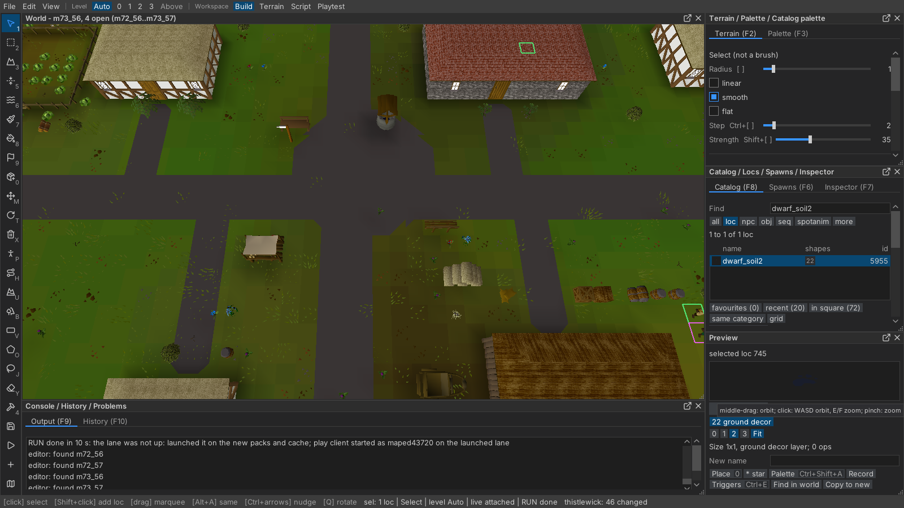

1. **Pick overlay** `10` in the Palette.
2. **Region** (O, `tool.region`), **overlay**, shapes **paved** (straight edges
   and 45-degree corners only), **Hardness** 50.
3. Tick **Straight lines** (or hold **Shift** at the press for one stroke):
   each stroke is one straight run from tile centre to tile centre, held to
   0, 45 or 90 degrees, so a hand that wanders does not. *Region: a straight
   run, held to 0/45/90 degrees on tile centres; release lays it*.
4. The main road: **Radius (half tiles)** 3, strokes along one row, 20 tiles
   at a time (each stroke snaps to the same row, so they join exactly): three
   whole tiles wide, *Region: 62 tiles laid, 2 edge shapes* -- the only edge
   shapes are the rounded ends, which the next stroke covers.
5. The square: **Radius** 9 and a click on the crossroads: a round square whose
   rim is 45-degree steps.
6. A path to each door: **Radius** 2, from the road to the tile outside the
   door: one whole tile with a half tile either side.

**To take a road off**, keep its overlay picked and **Alt+drag** with the
Region brush: only that overlay comes off; a house floor of another overlay
beside it stays. (Paint overlay with **Pick overlay** `0` takes off *every*
overlay under the brush, floors included -- that is how the cottage lost the
boards inside its door while this village was built.)

Avoid **Paint path** with **Roughness** for village roads: it frays both edges
by up to two tiles on purpose (it suits a forest track or a river).

### Lift the ground off h1

Real ground averages about h28 (Rimmington runs from h1 to h80). A square made
at h1 can only go up, so first lift the whole village: **Height**, **raise
only**, **Radius** 12, **Strength** 100, **Grid height** 16, broad strokes
over everything inside the hills. Buildings standing on it stay level: a
uniform lift moves them with the ground.

### Hills round the edge

The village sits in a shallow valley so that its edge is a wooded ridge, not
the end of the world:

1. **Height** (3, `tool.height`), **raise only**, **Radius** 8, **Strength** 60.
2. **Grid height** 30: the brush pulls the ground up to that height and no
   further, so overlapping strokes do not stack.
3. Drag a ring about seven tiles in from the edge of the four squares.
4. **Grid height** 48, **Radius** 5, a second ring three tiles in.
5. **Smooth** (6, `tool.smooth`), **Radius** 6, along the inside of the ring.
6. **Roughen** (U, `tool.noise`), **Hills (tiles)** 10, **Detail** 40,
   **Strength** 80, over the open fields: gentle rolls, not a table top.

The Inspector (F7) reads a hovered tile's height: `height h30 (authored)`.

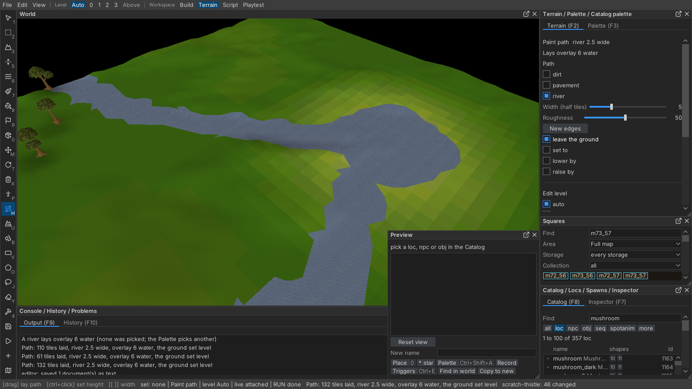

### Water

- **The pond**: pick *sand* in the Palette (**Pick underlay** takes a name:
  `sand`), Paint underlay round the spot at **Mix** 100 for the shore; then
  **Pick overlay** `water` and the **Region** tool (O, `tool.region`),
  **Radius (half tiles)** 5, a small loop. To sink it, Height with **lower
  only**: its first drag lowers the ground one Step.
- **The stream**: Paint path, **Path** *river*, **Width** 5, **set to** with
  **Height (units of 8)** 0. It cuts its own channel through the hills down to
  the pond and out of the far side.

### The ground's colour

A real village mixes six to eight underlays (Rimmington: 48, 66, 63, 49, 50,
56, 64), in solid patches several tiles across; the client blends the borders
between them, so the ground shades from one tone to the next.

The Palette knows floors by name or id: type `meadow grass` (49), `dry grass`
(50), `dark grass` (33), `dark earth` (63), `earth` (64), `48` into **Pick
underlay**, and hover a swatch to read its name.

1. Paint underlay (7), **Mix (%) 100**, **flat**, **Radius** 8: a base coat of
   grass 48 over the whole village.
2. Then solid blobs, **Mix 100**, **Radius** 4-7: about twenty of meadow 49 and
   a dozen of dry grass 50 anywhere; dark grass 33 towards the woods; and small
   ones (**Radius** 2-3) of earth 64 and dark earth 63 round the square and the
   doors, where feet wear the grass away.

**Keep Mix at 100.** Mix is the share of tiles a stroke paints, not a blend: a
40% stroke leaves a checkerboard of single tiles that the client draws as a
speckle of hard little squares. Solid patches are what blend.

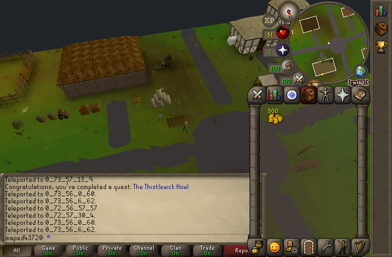

## 4. Buildings

The **Building** tool (4, `tool.building`) makes a whole house from one drag.

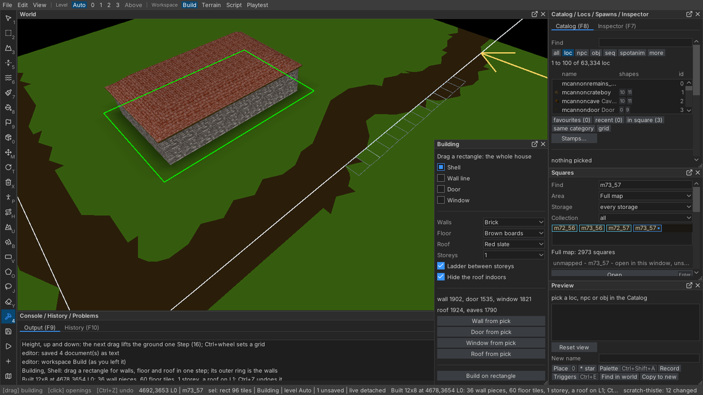

1. **Shell**. Choose **Walls** (*Timber and plaster*, *Brick*, *Old stone*,
   *Wooden planks*, *Wooden fence* ...), **Floor** (*Wooden planks*, *Brown
   boards*, *Grey flagstones* ...), **Roof** (*Thatch*, *Red slate*,
   *Wooden shingles* ...) and **Storeys**.
2. Drag the footprint. Its outer ring is the walls: a 12 x 8 drag is a hall
   with a 10 x 6 room. One drag, one undo step:
   *Built 12x8 at 4678,3654 L0: 36 wall pieces, 60 floor tiles, 1 storey, a
   roof on L1*. **Hide the roof indoors** sets the tiles' *remove roof* flag, so
   the roof hides when the player walks in. A house built over ground you
   already dressed takes the grass, soil and twigs off its own tiles in the
   same step (a fence's pen keeps them).
3. **Door**, then click a wall piece: the door of that wall's style goes in,
   turned the right way. Click it again for the wall back.
4. **Window**, then click wall pieces.

Thistlewick's buildings:

| Building | Walls | Floor | Roof | Footprint |
|---|---|---|---|---|
| Elder's hall | Brick | Brown boards | Red slate | 12 x 8 |
| Cottage | Timber and plaster | Wooden planks | Thatch | 9 x 7 |
| The old mill | Wooden planks | Dark boards | Wooden shingles | 10 x 8 |
| Sheep pen | Wooden fence | None | None | 8 x 8, a gate as its door |
| West house | Timber and plaster | Wooden planks | Thatch | 7 x 6 |
| North house | Brick | Brown boards | Red slate | 7 x 6 |
| Smithy | Old stone | Grey flagstones | Grey slate | 7 x 6, an `anvil` inside |
| Garden | Picket fence | None | None | 7 x 7, `cabbage`s on dark earth |

Keep them close: in Rimmington the houses stand two to four tiles apart round
the square, their doors on the road. A village spread over an empty field
looks like a field.

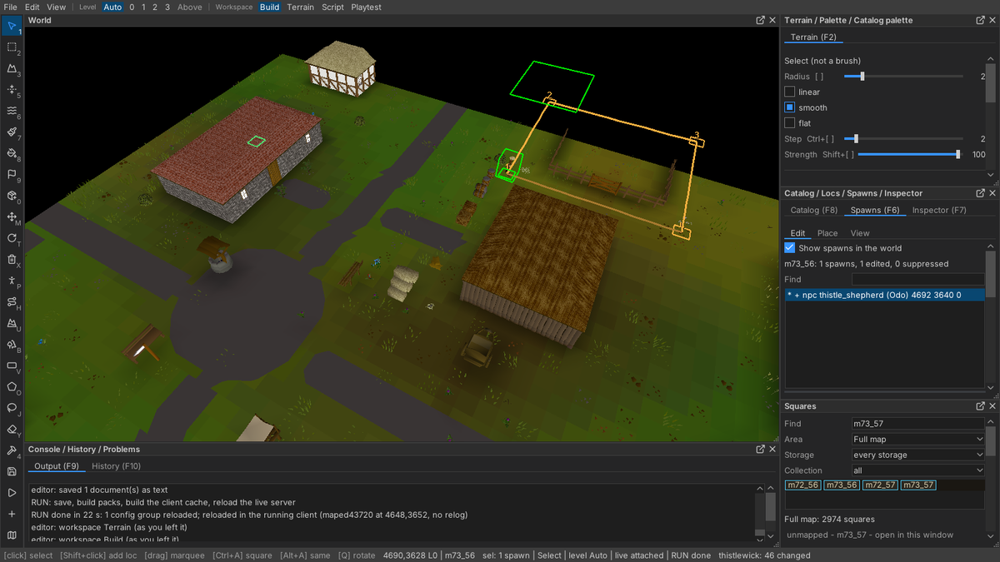

### Stamps: the same cottage again

1. **Rectangle** (2, `tool.rect`), drag round the cottage.
2. In the **Rectangle** panel type a **Stamp name** (`thistle_cottage`), keep
   **All levels** ticked (the roof is on level 1), press Enter:
   *Saved stamp thistle_cottage: 95 locs ... to editor/stamps/thistle_cottage.stamp*.
3. Catalog > **Stamps...** (`view.stamps`), click the stamp, **Q** turns it
   90 degrees, click where it goes, **Esc** puts it away.

## 5. Decorating

**Furniture.** The **Catalog** (F8) finds things by name: `table`, `chair`,
`bookcase`, `fireplace`, `rug`. Click a row: *Picked longtable: Place is
armed, a click puts it down (Q turns it, a drag lays a run)*. Pin level 0
(Alt+0, `level.pin0`) to see inside with the roofs hidden. In the hall: a
`longtable` with four `chair`s, a `bookcase` against the north wall,
`fenk_fireplace` on the east wall and a strip of `poh_rugmiddle1`.

Mind a piece's **footprint** (the Locs panel shows it for the selection:
*Footprint 1x2*). A 1x2 bookcase put down at the wrong turn runs across the
wall tile and stands half outside the house, its back to the lane; select it
and press **Q** until its long side lies along the wall: *Rotated 1 loc a
quarter turn: loc 380 now at rotation 1*. Look from outside as well as in.

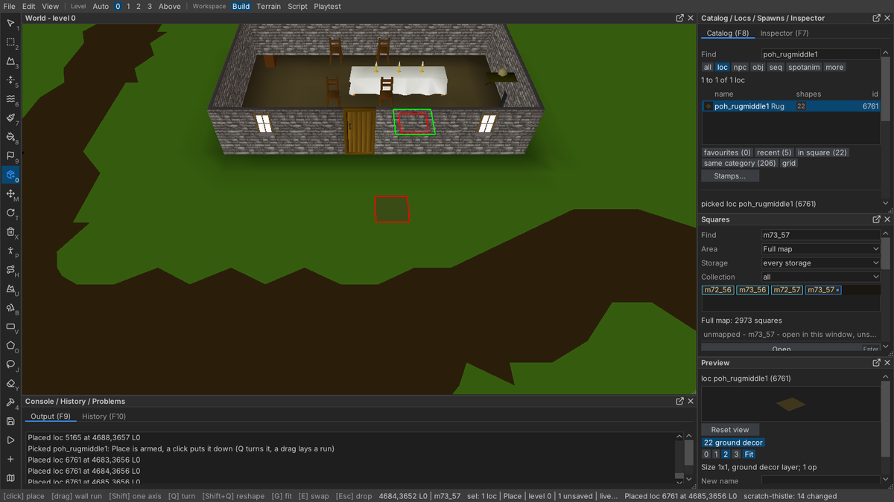

**The square and the doors.** A `well` in the middle of the square, a
`signpost`, `bench` and `bench2`, a `seed_stall`. At the mill door
`crate2_old`, `crate_old`, `sacks`, `barrel_stacked`, `hay_1` / `hay_2`; a
`logpile` by the west cottage, `plant2` / `plant3` either side of the hall
and cottage doors, a `wheel_barrow` by the field, an
`eadgar_druid_washing_line` behind a house. Flower beds are a two-tile patch
of dark earth 63 with `redflower`, `blueflower` and `rareflowers_blue` on it;
`bush1` along the walls. These are the props Rimmington, Draynor and
Lumbridge use most.

**What makes it look like RuneScape.** Look at what Jagex's own squares are
made of: counting the locs in the ten squares round Lumbridge, the most
common by far are ground dressing, not buildings: `short_grass_1` (2,358),
`short_grass_2..4`, `broken_twig`, `full_twig`, dug-up soil patches,
`daisys`, `shaggy_grass2/3`, `thistle`, and `fencing`. Use the **Scatter**
tool (B, `tool.scatter`) for them:

1. Pick the loc in the Catalog (Scatter keeps its turn: the pick is what it
   scatters).
2. **Density (%)** low: 6 for `short_grass_1`, 4 and 3 for `_2` and `_3`, 2 for
   `broken_twig` and `thistle`, 1 for `daisys`.
3. Keep **Bare ground only** ticked: roads, floors, water, roofed tiles
   (indoors, even where a floor tile is missing) and tiles that already hold
   a loc are skipped, so no grass grows in a cottage.
4. Drag broad strokes over the fields. Alt+drag erases what this pick put down.


**Fields.** The Building tool with **Walls** *Wooden fence*, **Floor** and **Roof**
*None* fences a field in one drag, and **Door** on a fence piece makes a two-leaf
gate. Then Scatter the crop inside at a high density: `fai_varrock_wheat` (the
Lumbridge wheat) at 75%, `potato` at 70%. Bare ground only keeps it off the fence.

**Forest.** The same tool on the hills: `tree` at 22%, `tree2` at 14%, a few
`deadtree1` at 3%. Woods on the ridge also hide the edge of the map.

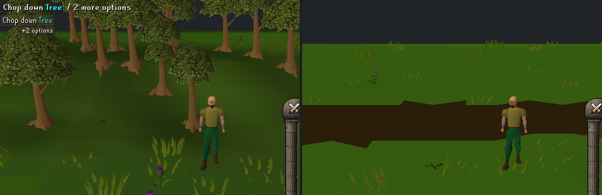

## 6. Records of your own: copies with their own identity

A trigger is attached to a record's **name**. If the quest's hay bales were
the cache's `haystack`, every haystack in the game would hand out the cellar
key. So every npc, loc and obj the quest scripts is a **copy**: it looks
exactly like its source but has a name, and an id, of its own.

In the Catalog: pick the source row, type **New name**, press **Copy to new**
(`catalog.copy_new`):

*Copied: loc thistle_haybales (65476) is picked; place it like any other.
Scripts name it [oploc1,thistle_haybales]*

| Copy | Source | What it is |
|---|---|---|
| `thistle_elder` | `shayzien_oldman` (npc) | Elder Bramwen |
| `thistle_shepherd` | `farmer1` (npc) | Odo |
| `thistle_greyfang` | `wolf` (npc, level 64) | Greyfang |
| `thistle_haybales` | `haystack` (loc) | the searchable hay bales |
| `thistle_cellar_door` | `trapdoor` (loc) | the mill's cellar door |
| `thistle_den_ladder` | `ladder` (loc, `#16683`) | the way out of the den |
| `thistle_cellar_key` | `closet_key` (obj) | the key |
| `thistle_pelt` | `werewolve_fur` (obj) | Greyfang's pelt |

Tips: a kind prefix finds the right list (`npc:farmer`, `obj:key`,
`loc:#16683` for an id). A copy is drawn and placeable at once; nothing needs
Save, RUN or a restart. A copied npc carries its source's combat fields
(hitpoints, attack anims, attack rate), so a copied wolf fights like a wolf.

**Rename it.** **Edit record...** opens the copy in the **Record** panel. Type
the field in **Field** (`name`, `op1`, `desc`), the text in **Value**, **Set
field**: *Set npc thistle_elder: name = Elder Bramwen*. Give the hay bales
`op1=Search`, the door `op1=Open`, the ladder `op1=Climb-up`. Take options
the role should not have off a copy (`op2`/`op3` = `default`): a shepherd
copied from a farmer keeps the farmer's *Attack* and *Pickpocket*, and an
attackable npc's left click becomes *Walk here*.

Loc copies get ids from 64000 up: every packet that names a loc carries 16
bits, so a loc id must stay under 65536 for its options to reach a script.

## 7. Npcs and a patrol route

**Placing.** Pick the npc in the Catalog (`npc:thistle_elder`), and click a
tile: *Placed npc thistle_elder at 4686,3659 L0*. The first spawn turns on
**Show spawns in the world** so you see it standing there.

**A patrol.** Odo walks round the sheep pen:

1. Click Odo in the World, then **View > NPC editor** (`view.npcbuilder`); it
   opens on him, **Movement** tab. (A patrol belongs to the npc *type*; if
   other spawns share it, the tab offers **Make own type**.)
2. **Add waypoint**, then click the tiles in walking order: the four corners
   outside the pen. The route is drawn with numbered markers, and the leash is
   raised to cover it by itself: *leash (maxrange) raised to 12 so the whole
   route is inside it*.
3. Pick a row in the route list, type 5 in **Pause (ticks)**: Odo stops at
   that corner. The lap line totals it: *lap: 4 legs, 46 steps + 10 pause = 56
   ticks (33 s)*.
4. A red leg is one he would get stuck on; **Fix stuck legs** (`npc.fix_legs`)
   adds the fewest waypoints round what stops him. The goal is *every leg
   walks: it is never stuck and never teleports*.
5. **Play** walks a marker round the route at walking speed.

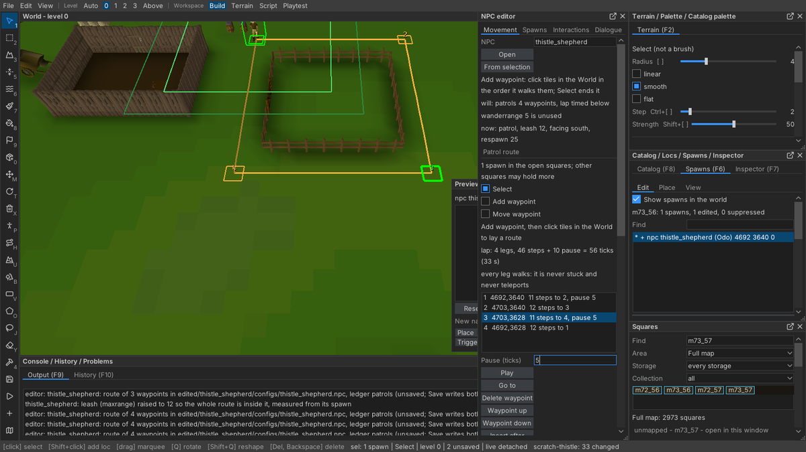

The route is written to `server/scripts/edited/thistle_shepherd/configs/thistle_shepherd.npc`
(`defaultmode=patrol`, `patrol1..4`, `maxrange`). Greyfang is not placed on
the map: the quest spawns him in the den.

## 8. The quest's scripts, in VS Code

Open **View > Triggers** (Ctrl+E), type `thistlewick` in **Quest name**, press
**New quest** (`file.new_quest`):

*Quest thistlewick made, its variable %varp9517_thistlewick_quest: quests/quest_thistlewick (lane scratch-thistle), opened in VS Code*

It makes, in the lane:

```
server/scripts/quests/quest_thistlewick/
    configs/quest_thistlewick.varp       the quest's variable, with an id already
    configs/quest_thistlewick.constant   its stages
    scripts/quest_thistlewick.rs2        cheats, and a commented Talk-to to start from
```

and opens the folder in VS Code (or whatever `TORIRS_EDITOR_OPEN_CMD` names).
These files are the lane's own: save them from VS Code and they stay in the
lane, never in the base tree. **Show in Explorer** makes the whole folder the
lane's before it shows it.

The Triggers panel's **Snippet** list has starting points to copy: *Boss:
swing, telegraphed special, death*, *Instance: enter a private copy, leave*,
*Cutscene frame: fade, lock, camera, unlock*, *Npc: patrol route*, *Quest
journal proc*. **Copy name** puts a record's name on the clipboard.

**Check** (Ctrl+Shift+B, `file.check_scripts`) compiles the lane: *check: ok,
3.6 s*, or rows in **Problems** that open the file at the line.

### The stages

`configs/quest_thistlewick.constant`:

```
^thistlewick_not_started = 0
// Elder Bramwen asked for help: talk to Odo.
^thistlewick_started = 1
// Odo told where the wolf goes, and where he hid the cellar key.
^thistlewick_heard = 2
// The cellar door is unlocked for good: the den can be entered again without the key.
^thistlewick_unlocked = 3
// Greyfang is dead: take his pelt to the elder.
^thistlewick_slain = 4
^thistlewick_complete = 5

^thistlewick_village = 0_72_56_63_63

^greyfang_bites_per_pounce = 4
^greyfang_pounce_min = 10
^greyfang_pounce_max = 18
^greyfang_reg_bites = 0
^greyfang_reg_target_x = 1
^greyfang_reg_target_z = 2
```

A coord is `level_squarex_squarez_tilex_tilez`: the Inspector and the status
bar show the square and the tile inside it.

A stage is a fact about the world, not a step of the walkthrough. *Unlocked*
is there so that a player who dies in the den, or climbs out to heal, can go
back down without hunting for a key that was used up.

## 9. Dialogue and triggers

The whole of `scripts/quest_thistlewick.rs2` is in the appendix; these are the
patterns it uses.

**Talk-to by stage.** One `[opnpc1,<npc>]` per character, branching on the
quest variable; long branches go in labels:

```
[opnpc1,thistle_elder]
if (%varp9517_thistlewick_quest = ^thistlewick_not_started) {
    @thistle_elder_offer;
} else if (%varp9517_thistlewick_quest = ^thistlewick_slain) {
    @thistle_elder_finish;
} ...

[label,thistle_elder_offer]
~chatnpc_anim(^chat_sad, "Welcome to Thistlewick, though you find us in a sorry state. Three sheep gone in a week.");
~chatnpc_anim(^chat_worried, "And every night a howl that seems to come up out of the ground itself.");
switch_int (~p_choice3("Out of the ground?", 1, "What can I do?", 2, "I'm only passing through.", 3)) {
    case 3 :
        ~chatplayer_anim(^chat_neutral, "I'm only passing through.");
        return;
    case 1 :
        ~chatplayer_anim(^chat_quiz, "Out of the ground?");
        ~chatnpc_anim(^chat_neutral, "My grandmother told of a great grey wolf, Greyfang, that denned in a cave under this hill.");
        ...
}
~chatnpc_anim(^chat_quiz, "Will you find out what is taking our sheep, and put an end to it?");
if (~p_choice2_header("Yes.", 1, "No.", 2, "Start The Thistlewick Howl?") = 1) {
    %varp9517_thistlewick_quest = ^thistlewick_started;
    mes("You've started a new quest: @q_mes@The Thistlewick Howl</col>");
```

Give every character something to say at every stage, before the quest and
after it too: Odo greets a stranger with *Can't stop to chat. Somebody has to
count them*, and when it is over, *Every one of them counted this morning, and
every morning since*. A line that tells the player where to go next (*the sheep
pen, just east of the old mill*) has to be true of the map: walk it.

`~chatnpc_anim` / `~chatplayer_anim` take an expression (`^chat_neutral`,
`^chat_happy`, `^chat_sad`, `^chat_quiz`, `^chat_worried`, `^chat_shock` ...),
`~p_choice2` / `~p_choice3` return the chosen option's number, and `~objbox`
shows an item with a line of text.

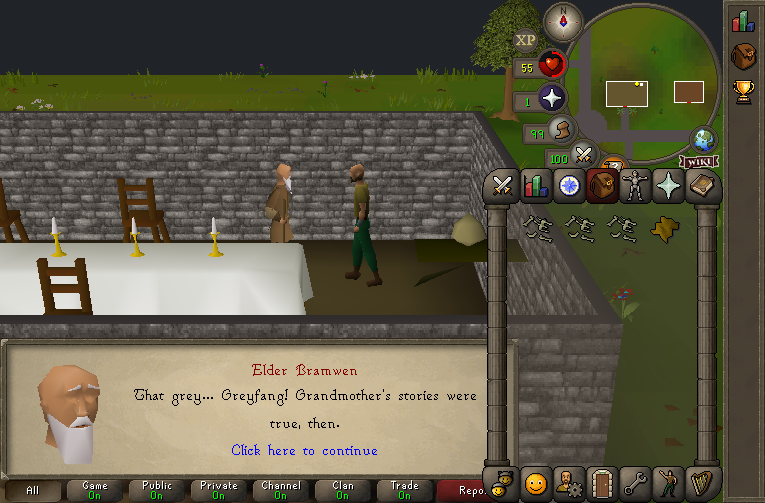

**A searchable loc.** The hay bales give the key only at the right stage, and
only once:

```
[oploc1,thistle_haybales]
if (%varp9517_thistlewick_quest ! ^thistlewick_heard) { mes("Just hay."); return; }
if (inv_total(inv, thistle_cellar_key) > 0) { mes("You find nothing else in the hay."); return; }
anim(human_pickupfloor, 0);
p_delay(1);
inv_add(inv, thistle_cellar_key, 1);
~objbox(thistle_cellar_key, "Right at the bottom of the hay, where Odo said, you find the miller's old iron key.");
```

**A locked door** checks the stage and the key. The first time, the key is
used up and the door stays unlocked; every time, it goes down into the den
(sections 10 and 11), and the cutscene plays only on the first:

```
[oploc1,thistle_cellar_door]
...
if (%varp9517_thistlewick_quest = ^thistlewick_heard) {
    if (inv_total(inv, thistle_cellar_key) < 1) {
        mes("The cellar door is locked. Odo hid the key in the hay bales by the mill.");
        return;
    }
    inv_del(inv, thistle_cellar_key, 1);
    %varp9517_thistlewick_quest = ^thistlewick_unlocked;
    mes("The old key turns stiffly. Cold air and the smell of wet fur come up from below.");
    ~thistle_den_enter(true);
    return;
}
if (%varp9517_thistlewick_quest >= ^thistlewick_slain) {
    mes("You climb down into the empty den.");
}
~thistle_den_enter(false);
```

## 10. A cutscene with a pathed camera

The cutscene shows the player what they walked into: the camera starts at the
foot of the ladder, glides down the cave past the bones and holds on Greyfang
standing on his bed of straw. Then he howls and comes for them. It plays
inside the player's own copy of the den (section 11), so its keyframes are
offsets inside the template, not world tiles.

Open the den's template first (**Squares** > Find `m0_100` > **Open**), then
**View > Camera path** (`view.campath`):

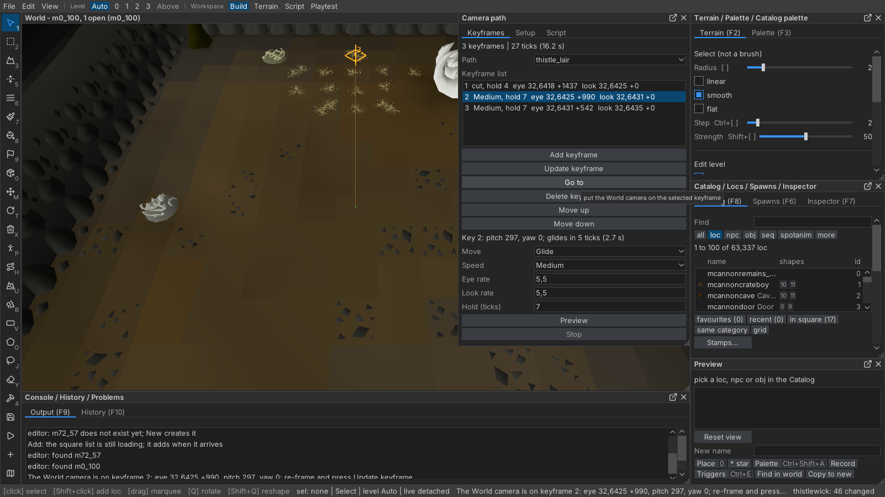

1. **Setup** tab: **Name** `thistle_lair`, **New path**. **Coordinates**
   *Instance-relative*, **Template** `m0_100`: *thistle_lair is
   instance-relative: offsets from m0_100's south-west tile, and the proc
   takes the instance's $handle*. Keep **Wrap in a cutscene frame** ticked
   (fade out, lock the camera and hide the HUD before; the reverse after).
2. **Keyframes** tab: fly the World camera to the first framing, looking up
   the cave from the ladder, and press **Add keyframe**
   (`campath.add_keyframe`); then down the cave past the bones; then close on
   the bed. Each says what the game will show: *Added keyframe 3 (glide
   Medium, hold 7): eye 32,6431 +542 looks at 32,6435 +0*. The camera snaps to
   the framing the game can reproduce, so what you see is what plays.
3. Pick a row to set **Move** (*Cut* / *Glide*), **Speed** and **Hold
   (ticks)**. A slower glide raises the hold so it still arrives.
4. **Preview** (`campath.preview`) flies the World camera along it with the
   game's easing; **Stop** brings it back.
5. **Script** tab, **Copy script** (`campath.copy_script`): *Copied
   [proc,thistle_lair_camera] (27 lines): paste it into your quest's .rs2
   and call ~thistle_lair_camera($handle);*

The path is saved in the lane as `editor/campaths.txt`, so it can be reopened
and re-framed (**Go to**, move the camera, **Update keyframe**) and copied
again. The proc it writes, pasted at the end of `thistle_den.rs2`:

```
[proc,thistle_lair_camera](int $handle)
~fade_screen(0, 255, 0, 0);
p_delay(1);
~cutscene_lock(3, 0);
~cutscene_hud_lock;
p_delay(0);
cam_moveto(map_instance_coord($handle, 32, 18, 0), 1437, 232, 232);
cam_lookat(map_instance_coord($handle, 32, 25, 0), 0, 232, 232);
p_delay(0);
~fade_screen(0, 0, 0, 255);
p_delay(2);
cam_moveto(map_instance_coord($handle, 32, 25, 0), 990, 5, 5);
cam_lookat(map_instance_coord($handle, 32, 31, 0), 0, 5, 5);
p_delay(6);
cam_moveto(map_instance_coord($handle, 32, 31, 0), 542, 5, 5);
cam_lookat(map_instance_coord($handle, 32, 35, 0), 0, 5, 5);
p_delay(6);
~fade_screen(0, 255, 0, 0);
p_delay(1);
~cutscene_unlock;
~cutscene_hud_unlock;
p_delay(1);
~fade_screen(0, 0, 0, 255);
p_delay(1);
if_closesub(toplevel_osrs_stretch:overlay_atmosphere);
```

The den's entry (section 11) calls it after the player has landed and
Greyfang has been put on his bed, and wakes him once it is over. A path over
the real map is the same with **Coordinates** *World tiles*: the proc then
names tiles (`cam_moveto(0_72_56_38_46, ...)`) and takes no handle.

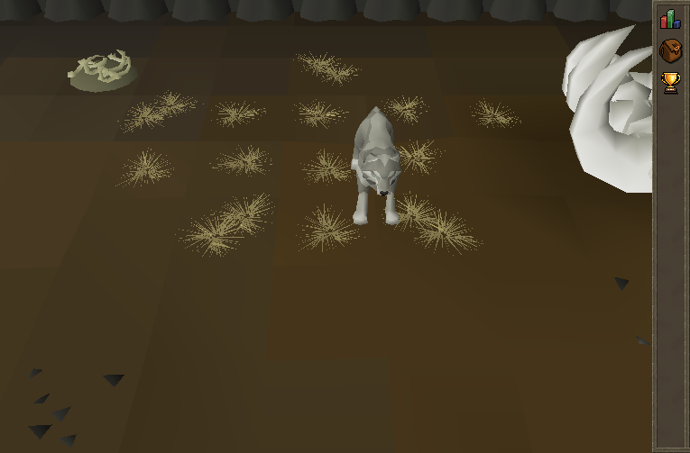

## 11. Instances: templated, then stamped

An **instance** is a private copy of part of the map, made for one player (or
a party) when they enter and thrown away when they leave. Two places matter:

| | Where | What it is |
|---|---|---|
| **Template** | instance space: squares x 0..19, z 100..255 | ordinary map squares you build in the editor. No world-map area claims them and nobody walks them. |
| **Copy** | the instance pool: squares x >= 100 (tiles x >= 6400) | stamped from the template at play time by `~map_instance_from_square_block`, one per entry; tiles, locs, every level. |

So you edit the template like any other square, and every entry after the
next Save and RUN gets the new version.

**File > New instance...** (`file.new_instance`):

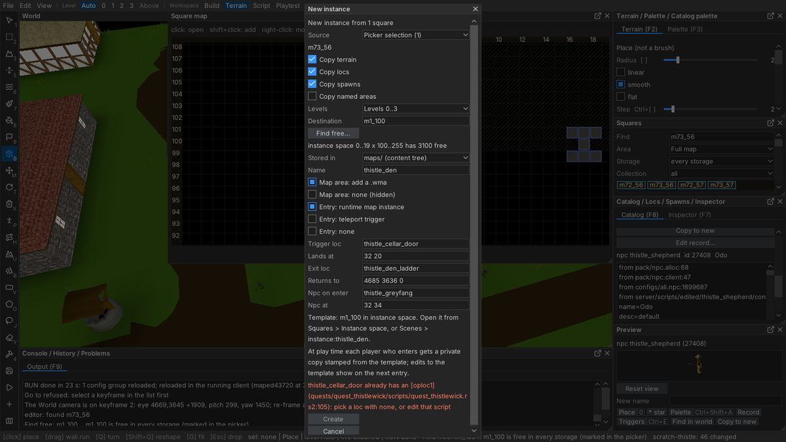

1. **Source**: the squares to copy into the template (the open set, or a
   selection on the Square map). The den started as a flat scratch square
   (File > New square with no Place at) and was built after.
2. **Destination**: **Find free...** picks one in instance space (`m0_100`).
3. **Name**: `thistle_den`. **Entry: runtime map instance** (the default).
4. **Trigger loc**: `thistle_cellar_door`. **Lands at**: where the player
   appears, as an offset inside the copy (`32 20`), a tile of the source
   square, or of the template. **Exit loc**: `thistle_den_ladder`; **Returns
   to**: the real-map tile beside the door (`4685 3636 0`). **Npc on enter**:
   `thistle_greyfang`, **Npc at** `32 34`.
5. The two lines under the fields say where things are: *Template: m0_100 in
   instance space. Open it from Squares > Instance space, or Scenes >
   instance:thistle_den.* and *At play time each player who enters gets a
   private copy stamped from the template; edits to the template show on the
   next entry.*
6. **Create**, then Save all.

It writes `server/scripts/edited/thistle_den/scripts/thistle_den.rs2`, a
working enter / spawn / exit script with a header that repeats where the
template and the copies are.

### Building the den

The den is a wolf's cave, so build it the way Jagex built the Lumbridge Swamp
caves (`m50_150`; open it and read its files as you read Rimmington's): rock
walls that face the room, solid rock behind them, an earth floor, and the
story told in what lies on it.

1. **The floor.** **Rectangle** over the room and a ring round it, **Pick
   underlay** `64` (*earth*) with no overlay picked, **Fill with palette**:
   *Fill: 459 tiles changed; underlay 64 earth (dirt), overlay taken off*.
   Then Paint underlay at **Mix** 100, **smooth**, in blotches of `63` (*dark
   earth*) and `56` (*rock*), and **Roughen** with **Hills (tiles)** 3,
   **Strength** 35: the floor goes from h18 to h22, never a table top.
2. **The walls.** Catalog `swamp_cavewall1` (and `swamp_cavewall2` for
   variety), **Place**, and drag a run along each side of the room (Shift
   keeps it on one row): *Place run: placed 13 of 13 tiles*. A cave wall faces
   away from the rock behind it -- rotation 3 for the north wall, 1 the south,
   2 the west, 0 the east (Q turns the ghost; the run selects what it placed,
   so the Locs panel shows its rotation). The four corners are
   `swamp_cavewallinsidecorner`, and a ring of `swamp_cavewall_top1` behind
   the walls is the rock itself.
3. **The story.** At the far end, Greyfang's bed: `straw` and `straw2` on a
   3 x 3 patch, a `carcass` beside it. Bone piles
   (`magictraining_bones_pile1..3`, `death_trollleftovers`) along the way in,
   `stalagmite_large_vdarkbrown` and `stalagmite_twin` in the corners, two
   `puddle`s, and `dwarf_soil1` / `dwarf_soil2` scattered thinly. The
   template's tiles carry the *remove roof* flag, so untick **Bare ground
   only** for that Scatter (Scatter says so when it lays nothing for that
   reason).
4. The `thistle_den_ladder` copy at the landing (`32 18`).

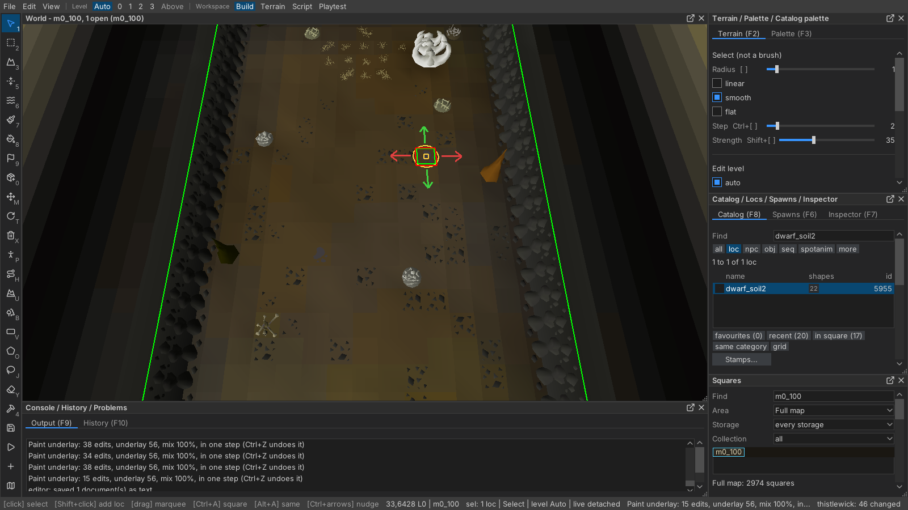

Overlay 48 (*dark grey*), the swamp caves' floor, renders black under this
lighting and reads as holes: keep the cave floor in underlays.

### The entry

The generated entry, turned into a proc the cellar door calls. Greyfang is put
on his bed before the cutscene and woken after it; once he is dead the den is
empty, and a pelt the player left behind is back on the bed:

```
[proc,thistle_den_enter](boolean $first)
def_int $handle = ~map_instance_from_square_block(0_0_100_0_0, 1, 1);
if ($handle = ^map_instance_none) {
    mes("There is no room for another instance just now.");
    return;
}
%varp6600_map_instance_handle = $handle;
p_telejump(map_instance_coord($handle, 32, 20, 0));
map_instance_spawnnpcs($handle);
if (%varp9517_thistlewick_quest >= ^thistlewick_slain) {
    if (%varp9517_thistlewick_quest = ^thistlewick_slain & inv_total(inv, thistle_pelt) < 1) {
        obj_add(map_instance_coord($handle, 32, 36, 0), thistle_pelt, 1, 200);
        mes("Greyfang's pelt still lies on his bed of straw.");
    }
    return;
}
~greyfang_spawn(map_instance_coord($handle, 32, 35, 0));
if ($first = true) {
    ~thistle_lair_camera($handle);
}
if (npc_find(coord, thistle_greyfang, 20, 0) = true) {
    npc_say("Aroooooooo!");
    npc_queue(5, 0, 1);
}

[oploc1,thistle_den_ladder]
if (map_instance_find(coord) = ^map_instance_none) {
    return;
}
~map_instance_release_here;
p_telejump(0_73_56_13_52);
```

The pieces: `~map_instance_from_square_block(<template SW>, w, h)` stamps a
copy and returns its handle (`^map_instance_none` when the pool is full);
`map_instance_coord($handle, dx, dz, level)` is a tile of the copy, `dx, dz`
counted from the template's south-west corner; `%varp6600_map_instance_handle`
is where the player's handle is kept; `~map_instance_release_here` frees the
copy the player stands in (with its npcs); `npc_find(coord, <npc>, distance, 0)`
makes the npc found the one the `npc_` commands that follow act on. Read
`general/scripts/misc/map_instance_procs.rs2` and `docs/map_instances.md`.

## 12. The boss

Greyfang is a copied wolf, so he already bites like one. He is spawned
without a target, so he waits on his bed through the cutscene; the den's entry
wakes him with `npc_queue(5, ...)`, whose `[ai_queue5,thistle_greyfang]` sends
him for the player (`huntall`, `npc_setmode(opplayer2)`).

The script adds one special attack in the shape Brutus uses: every fourth bite
he **telegraphs**, the player has two ticks to move, and then it lands.

```
[ai_opplayer2,thistle_greyfang]
if (npc_stat(hitpoints) = 0) { return; }
~greyfang_reg_set(^greyfang_reg_bites, calc(~greyfang_reg(^greyfang_reg_bites) + 1));
if (~greyfang_reg(^greyfang_reg_bites) >= ^greyfang_bites_per_pounce) {
    ~greyfang_reg_set(^greyfang_reg_bites, 0);
    ~greyfang_pounce_aim;
    return;
}
npc_anim(npc_param(attack_anim), 0);
~npc_meleeattack;
```

Naming `[ai_opplayer2,<npc>]` takes the npc out of the wildcard combat swing,
so the ordinary bite is restated in the last two lines.

**The telegraph:** he stops, says so over his head and in the chat box, and
marks the tile the player stands on:

```
[proc,greyfang_pounce_aim]
~greyfang_reg_set(^greyfang_reg_target_x, coordx(coord));
~greyfang_reg_set(^greyfang_reg_target_z, coordz(coord));
npc_bind(3);
npc_say("*Greyfang crouches low...*");
mes("Greyfang crouches low, eyes on you: move!");
npc_facesquare(coord);
spotanim_map(gargboss_debris_shadow_90, coord, 0, 0);
npc_attackdelay(4);
npc_queue(6, 0, 2);
```

**The pounce**, two ticks later, hits whoever still stands on the mark:

```
[ai_queue6,thistle_greyfang]
def_coord $target = movecoord(npc_coord, calc(~greyfang_reg(^greyfang_reg_target_x) - coordx(npc_coord)), 0,
    calc(~greyfang_reg(^greyfang_reg_target_z) - coordz(npc_coord)));
npc_anim(npc_param(attack_anim), 0);
spotanim_map(smokepuff, $target, 0, 0);
huntall(npc_coord, 12, 0);
while (huntnext = true) {
    if (coord = $target) {
        damage(uid, hitsplat_damage, ~random_range(^greyfang_pounce_min, ^greyfang_pounce_max));
        if (stat(hitpoints) = 0) { queue(player_death, 0, 0); }
    }
}
```

His fight state lives in the instance's own registers
(`map_instance_var_get/set(map_instance_find(npc_coord), reg)`): there is one
Greyfang per copy, however many players are fighting their own. **The death**
moves the quest on and drops the pelt, then hands over to the default death:

```
[ai_queue3,thistle_greyfang]
if (npc_findhero = true) {
    if (%varp9517_thistlewick_quest = ^thistlewick_unlocked) {
        %varp9517_thistlewick_quest = ^thistlewick_slain;
        mes("Greyfang falls. The howling under Thistlewick is over.");
        obj_add(npc_coord, thistle_pelt, 1, 200);
    }
}
~npc_default_death;
```

Use a copy for a boss: a cache monster with a drop table already has an
`[ai_queue3,...]`, and a second one stops the compile.

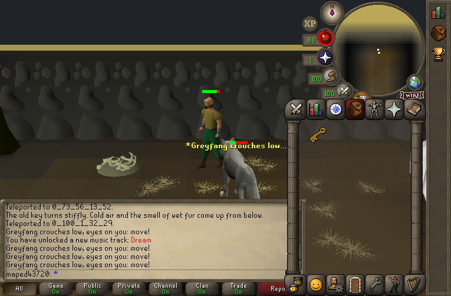

## 13. Journal, completion and rewards

A custom quest has no row in the client's quest list (that table is the
cache's), so its journal is a proc opened by a cheat, and the elder says
what is left. `~quest_journal(title, text)` draws the journal; `^journal_done`,
`^journal_todo`, `^journal_highlight` and `^journal_complete` colour it, `|`
breaks a line.

The rewards and the scroll:

```
[proc,thistlewick_rewards]
stat_advance(attack, 15000);          // tenths of a point: 1,500 xp
stat_advance(defence, 15000);
inv_add(inv, coins, 500);
~quest_award_points(1);
mes("Congratulations, you've completed a quest: @q_mes@The Thistlewick Howl</col>");
~quest_scroll_paint_titled(quest_cooksassistant, "You have completed The Thistlewick Howl!",
    append(~quest_points_reward(1), "1,500 Attack XP|1,500 Defence XP|500 coins"),
    coins_250, ^questscroll_model_x, ^questscroll_model_y);
```

`quest_cooksassistant` is only there for what the scroll reads from a quest
row (the jingle); the title and rewards are this quest's.

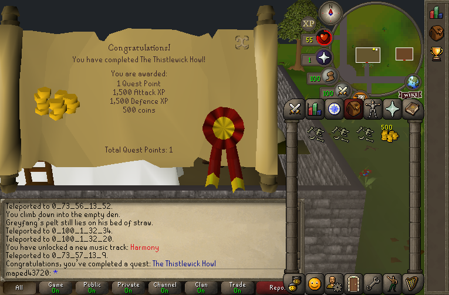

## 14. RUN, and playing it

**File > Run** (Ctrl+Enter, `file.run`) saves, builds the lane's packs and
client cache, starts (or reloads) the lane's servers and a **play client**
logged in as the lane's own account:

*RUN done in 34 s: the lane was not up: launched it on the new packs and
cache; play client started as maped43720 on the launched lane*

After a change to scripts only, RUN reloads the live server in a few seconds
without logging out (*RUN done in 7 s: 1 script reloaded*). A new variable, or
a record copied while the lane was live, needs **Restart lane**
(`file.restart_lane`); RUN's sentence says when.

In the play client, the cheats from section 8: `::thistlewick_tele` to the
village, `::thistlewick` to reset, `::thistlewick_journal`. Test levels:
`::setlevel 0 99` (0 attack, 1 defence, 2 strength, 3 hitpoints). The whole
quest:

1. Talk to Elder Bramwen in the hall: *Out of the ground?* for the legend,
   then *Yes.*
2. Talk to Odo while he walks round the sheep pen east of the mill.
3. Search the hay bales by the mill: the miller's key.
4. Open the cellar door inside the mill: down into the den, and the cutscene
   finds Greyfang on his bed.
5. Kill Greyfang; step off the marked tile when he crouches.
6. Take the pelt, climb the ladder, give the pelt to the elder. (Climbed out
   without it? Go back down: it is on his bed.)

The editor's **Live** panel moves the play account (**Teleport to
selection**), and the agent API drives the play client for automated tests
(`docs/AGENT_API.md`, *Driving the play client*).

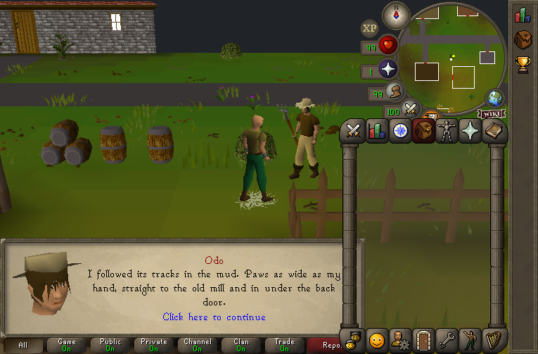

## 15. Promoting the scratch lane

When the quest works, make it a real lane: **File > Publish...**, **Changes**
tab. The list shows every file the lane changed (`A`, `M`, `D`, path, size);
**Diff against base** opens a changed file beside the base's in VS Code.

Type the lane's name in **New lane name** (`thistlewick`) and press **Promote
to new lane...** (`file.promote_lane`):

*Lane thistlewick made with 46 file(s); this lane (scratch-thistle) is
unchanged. To work in thistlewick: put lane=thistlewick under [editor:boot]
in your manifest, then launch the editor.*

The new lane's first RUN is a full build and its play account starts fresh:
here it built in 35 s, and the elder and Odo were waiting in the play client.
**Publish into lane...** is for publishing into a lane that already exists
(it shows a dry run first and asks again); the base tree is the last choice
in that list and asks for a confirmation that names it. **Delete lane...**
removes a scratch lane you no longer need without touching the base tree.

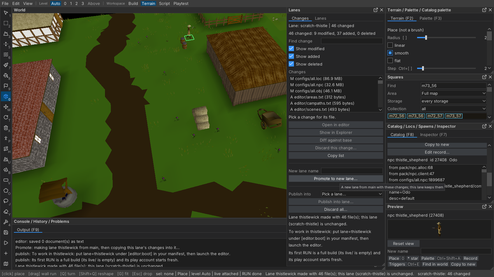

## 16. Things that catch people out

- **Jagged roads.** A road drawn freehand drifts, and every drift is a step
  the shapes draw as a tooth. Region with **paved** shapes and **Straight
  lines** (or Shift), section 3.
- **Shift+Alt+drag moves the window under the pointer**, the World too. A
  straight take-off is **Straight lines** ticked and a plain Alt+drag.
- **Taking a road off took a floor with it.** Paint overlay with overlay 0
  takes every overlay; Region's Alt+drag takes only the picked one.
- **Furniture through a wall.** A 1x2 piece at the wrong turn crosses the
  wall line; check its footprint and look from outside.
- **A cutscene in an instance** needs an *Instance-relative* path and the
  instance's `$handle`; world tiles point at the template, which nobody is
  standing in.
- **A speckled, single-coloured ground.** Paint underlays at Mix 100 in solid
  patches of several greens and earths; below 100, Mix scatters single tiles.
- **The square is too flat.** Real squares are never one height and one
  colour. Hills on the edges, Roughen on the fields, two or three greens, and
  hundreds of small ground locs (section 5) are what read as RuneScape.
- **A new square at h1 cannot be sunk.** 0 is the lowest the ground goes;
  Flat fill's default of h20 leaves room for ponds and streams.
- **Undo is per stroke.** Read the **History** panel (F10) before pressing
  Ctrl+Z several times; it lists each step with its tool and size, and it is
  cleared when the editor closes.
- **A trigger on a cache record changes it everywhere.** Copy first
  (section 6). The New instance dialog warns when a trigger loc has a
  category trigger it would override.
- **An attackable npc's left click is not Talk-to.** Take *Attack* off a
  copied villager in the Record panel.
- **A loc copy made before 2026-11-11 may have an id of 70000 or more.** Its
  options never reach a script (16-bit loc ids on the wire); copy it again.
- **A record copied while the lane was live** needs Restart lane before it
  spawns.
- **Scripts are written outside the editor.** Use the files the editor hands
  you (Open in editor, Show in Explorer): those are the lane's own. A file
  created by hand in a lane folder the editor never wrote may be a link into
  the base tree.

---

## Appendix: the scripts

`server/scripts/quests/quest_thistlewick/scripts/quest_thistlewick.rs2` and
`server/scripts/edited/thistle_den/scripts/thistle_den.rs2` in the
`thistlewick` lane, in full: see [QUEST_TUTORIAL_SCRIPTS.md](QUEST_TUTORIAL_SCRIPTS.md).
